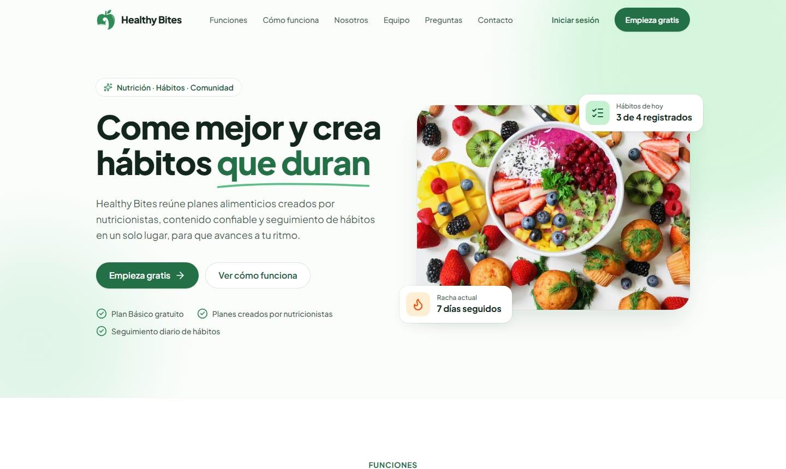

<div align="center">
  

  <h1>Healthy Bites · Landing page</h1>

  <p><strong>Nutrición, hábitos y comunidad en un solo lugar.</strong></p>

[](https://github.com/vfernandezg-dev/healthy-bites-landing/actions/workflows/ci.yml)
[](https://github.com/vfernandezg-dev/healthy-bites-landing/actions/workflows/deploy.yml)


[**Ver el sitio**](https://healthybites.vfernandezg.dev) ·
[Desarrollo](#desarrollo) ·
[Arquitectura](#decisiones-de-arquitectura) ·
[Equipo](#equipo)

</div>

<br />



## Sobre el proyecto

**Healthy Bites** es una plataforma de nutrición que reúne planes alimenticios creados por
nutricionistas, contenido educativo (videos, artículos y guías), seguimiento diario de hábitos, metas,
rachas con recompensas y grupos de comunidad. Este repositorio contiene su **landing page**: el sitio
público que presenta el producto y dirige a los usuarios a la aplicación.

Es un proyecto académico que forma parte de un sistema de tres repositorios:

| Repositorio                                                                       | Descripción                                                 |
| --------------------------------------------------------------------------------- | ----------------------------------------------------------- |
| [healthy-bites-landing](https://github.com/vfernandezg-dev/healthy-bites-landing) | Landing page (este repositorio)                             |
| [healthy-web-app](https://github.com/vfernandezg-dev/healthy-web-app)             | Aplicación web en Angular: registro, inicio de sesión y uso |
| [healthy-bites-api](https://github.com/vfernandezg-dev/healthy-bites-api)         | API REST en Spring Boot + PostgreSQL                        |

## Características

- **Diseño responsive** con sistema visual propio (tokens de marca con contraste AA).
- **Animaciones cuidadas:** entrada escalonada del hero, aparición de secciones al hacer scroll y un
  acordeón animado en las preguntas frecuentes. Todo respeta `prefers-reduced-motion`.
- **Accesibilidad WCAG 2.2 AA** verificada automáticamente con axe en escritorio y móvil.
- **Rendimiento:** HTML estático, cero JavaScript por defecto e imágenes AVIF/WebP responsivas.
- **SEO técnico:** URL canónica, Open Graph, Twitter Cards, datos estructurados (JSON-LD), sitemap y
  `robots.txt`.
- **Formulario de contacto** conectado a la API, con validación accesible, protección antispam y
  alternativa por correo si el servidor no responde.

## Stack

| Área           | Tecnología                                                                                              |
| -------------- | ------------------------------------------------------------------------------------------------------- |
| Framework      | [Astro 7](https://astro.build) (generación estática, arquitectura de islas)                             |
| Interactividad | [React 19](https://react.dev) solo en el formulario de contacto; TypeScript sin framework para el resto |
| Estilos        | [Tailwind CSS 4](https://tailwindcss.com), fuente Plus Jakarta Sans self-hosted                         |
| Iconos         | [Lucide](https://lucide.dev) renderizado a SVG en el build                                              |
| Calidad        | TypeScript estricto, ESLint (con reglas de accesibilidad), Prettier                                     |
| Pruebas        | Vitest + Testing Library, Playwright + axe                                                              |
| Entrega        | pnpm, GitHub Actions, GitHub Pages                                                                      |

## Decisiones de arquitectura

- **La landing no implementa autenticación.** El inicio de sesión y el registro viven en la aplicación
  web, que guarda la sesión (JWT) en su propio dominio. La landing solo enlaza a
  `PUBLIC_APP_URL/auth/login` y `/auth/register`: así no se duplica la lógica de autenticación ni se
  pasan tokens entre dominios.
- **Cero JavaScript por defecto.** Todas las secciones se renderizan a HTML en el build. El header
  (menú móvil y _scroll-spy_), las animaciones y el acordeón son módulos TypeScript pequeños y sin
  framework. React solo se descarga cuando el usuario llega al formulario de contacto
  (`client:visible`).
- **Contenido separado de la presentación.** Todos los textos y datos están en
  [`src/data/site.ts`](src/data/site.ts). Las funcionalidades descritas existen en la API; si cambian,
  se actualiza ese archivo.
- **Contacto.** El formulario envía `POST {PUBLIC_API_URL}/contact`, validando con las mismas reglas
  que el backend ([`src/lib/contact.ts`](src/lib/contact.ts)). Si la API no responde, ofrece un enlace
  `mailto:` con el mensaje ya escrito.
- **Supply chain.** pnpm solo instala versiones publicadas hace al menos 24 horas
  (`minimumReleaseAge` en [`pnpm-workspace.yaml`](pnpm-workspace.yaml)).

## Estructura del proyecto

```
src/
├── assets/            # Imágenes procesadas en el build (logo, hero, equipo)
├── components/
│   ├── contact/       # ContactForm (isla React) y sus tests
│   ├── layout/        # Header y Footer
│   ├── sections/      # Secciones de la página (Hero, Features, FAQ…)
│   └── ui/            # Componentes de presentación reutilizables
├── data/site.ts       # Contenido de la landing
├── layouts/           # BaseLayout: <head>, SEO, Open Graph, JSON-LD
├── lib/               # Configuración, lógica del formulario y utilidades de UI
├── pages/             # index, 404 y robots.txt
├── scripts/           # Header, animaciones y acordeón (TypeScript sin framework)
└── styles/global.css  # Tokens de diseño y animaciones
e2e/                   # Pruebas end-to-end y de accesibilidad
scripts/               # Generación de assets de marca (favicon, imagen OG, logo)
docs/                  # Recursos del README
```

## Desarrollo

### Requisitos

- **Node.js 24 LTS** (ver [`.nvmrc`](.nvmrc)).
- **pnpm**. La versión exacta está fijada en `package.json` (`packageManager`) y pnpm la usa
  automáticamente. El proyecto no admite npm ni yarn: `npm install` falla a propósito.

### Puesta en marcha

```bash
pnpm install
cp .env.example .env   # opcional: apunta a una API o aplicación web local
pnpm dev               # http://localhost:4321/
```

### Scripts

| Script              | Descripción                                                 |
| ------------------- | ----------------------------------------------------------- |
| `pnpm dev`          | Servidor de desarrollo                                      |
| `pnpm build`        | Build estático en `dist/`                                   |
| `pnpm preview`      | Sirve el build localmente                                   |
| `pnpm lint`         | ESLint (TypeScript, Astro, React Hooks, accesibilidad)      |
| `pnpm format`       | Formatea con Prettier                                       |
| `pnpm check`        | Chequeo de tipos de Astro y TypeScript                      |
| `pnpm test`         | Tests unitarios y de componentes (Vitest)                   |
| `pnpm test:e2e`     | Tests E2E y de accesibilidad WCAG 2.2 AA (requiere `build`) |
| `pnpm verify`       | Lint, formato, tipos, tests y build                         |
| `pnpm brand:assets` | Regenera logo transparente, favicon, iconos e imagen OG     |

La primera vez que ejecutes los tests E2E, instala el navegador con
`pnpm exec playwright install chromium`.

### Variables de entorno

| Variable         | Por defecto                                           | Uso                                  |
| ---------------- | ----------------------------------------------------- | ------------------------------------ |
| `PUBLIC_APP_URL` | `https://healthy-bites-v1.netlify.app`                | Enlaces a login y registro de la app |
| `PUBLIC_API_URL` | `https://healthybites-api-latest.onrender.com/api/v1` | Endpoint del formulario de contacto  |
| `SITE_URL`       | `https://healthybites.vfernandezg.dev`                | URL canónica, sitemap y Open Graph   |
| `BASE_PATH`      | `/`                                                   | Ruta base del sitio                  |

Para trabajar contra el backend local usa `PUBLIC_API_URL=http://localhost:8090/api/v1`.

## Calidad y despliegue

- Cada pull request pasa por [`ci.yml`](.github/workflows/ci.yml): lint, formato, tipos, tests
  unitarios, build y tests E2E con auditoría de accesibilidad.
- Cada push a `main` ejecuta [`deploy.yml`](.github/workflows/deploy.yml), que construye el sitio y lo
  publica en GitHub Pages con el dominio propio `healthybites.vfernandezg.dev` (DNS en Cloudflare). Las URLs de producción se configuran como _variables_ del repositorio
  (`Settings → Secrets and variables → Actions → Variables`): `PUBLIC_APP_URL` y `PUBLIC_API_URL`.

## Equipo

Healthy Bites es un proyecto académico. **Valentin Fernandez** lideró el proyecto y desarrolló y
configuró la plataforma completa: la API REST (Spring Boot + PostgreSQL), la aplicación web (Angular),
esta landing (Astro), el despliegue y la integración continua.

| Integrante         | Rol                        | Perfil                                                                    |
| ------------------ | -------------------------- | ------------------------------------------------------------------------- |
| Valentin Fernandez | Líder técnico · Full Stack | [LinkedIn](https://www.linkedin.com/in/vfernandezg-dev/)                  |
| Camila Moreno      | Diseño UI/UX               | [LinkedIn](https://www.linkedin.com/in/camila-moreno-quevedo-01871a324/)  |
| Alessia Aguilar    | Base de datos              | [LinkedIn](https://www.linkedin.com/in/alessia-aguilar-857670286/)        |
| Jhonnatan Chavez   | Arquitectura de software   | [LinkedIn](https://www.linkedin.com/in/jhonnatan-del-castillo-a73a24316/) |
| Renzo Lavado       | Comercial                  | [LinkedIn](https://www.linkedin.com/in/renzo-lavado-41aba2296/)           |

## Versión anterior

El sitio original (HTML + Bootstrap) se conserva en la rama
[`legacy`](https://github.com/vfernandezg-dev/healthy-bites-landing/tree/legacy), solo como referencia.
